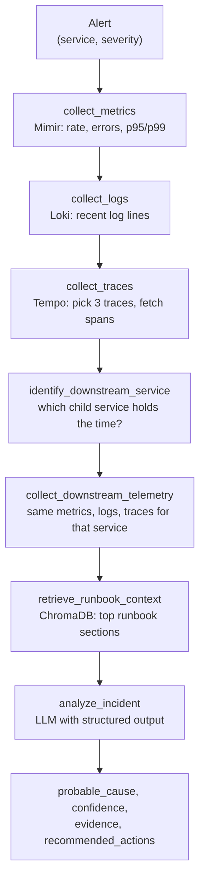

# ai-sre-incident-agent

A read-only incident investigation agent. Give it an alert, and it collects metrics, logs and traces for the affected service, follows the downstream service that is eating most of the request time, pulls the relevant runbook sections, and returns a root-cause hypothesis with the evidence behind it and a confidence score.

It never changes anything. It only reads from Mimir, Loki and Tempo, and every recommendation it makes is for a human to evaluate.

Built with FastAPI, LangGraph, LangChain and ChromaDB, against the [OpenTelemetry Demo](https://github.com/open-telemetry/opentelemetry-demo) running on a Grafana LGTM stack.

## How it works

The investigation is a fixed LangGraph pipeline. Each step adds to a shared state, and the model is called once at the end with everything that was collected.



1. **Metrics.** Detects whether the service exposes HTTP or gRPC server metrics, then queries request rate, error rate, p95 and p99 latency.
2. **Logs.** Pulls up to 100 recent log lines for the service in the incident window.
3. **Traces.** Searches Tempo for the service, then picks three traces to inspect in full. It prefers trace IDs whose log lines span the longest time, and falls back to the longest Tempo traces if the logs don't give three.
4. **Downstream service.** Looks for a span from another service whose parent belongs to the alerted service. If the biggest one takes at least 500 ms and at least half of its parent's time, the agent collects that service's telemetry too.
5. **Runbooks.** Turns the evidence into a plain-language query and retrieves the six most relevant runbook sections from 19 runbooks in [`runbooks/`](runbooks/).
6. **Analysis.** Sends everything to the model and gets back a typed `IncidentAnalysis` object: probable cause, confidence from 0 to 1, a list of evidence items each tagged as `metrics`, `logs` or `traces`, and recommended actions.

## Design decisions

**Read-only by construction.** The agent's only tools are HTTP GET clients for Mimir, Loki and Tempo. There is no Kubernetes client and no write path. The prompt also tells the model not to claim it took any action, but the real guarantee is that there is nothing for it to act with.

**Runbooks are reference material, not evidence.** Every runbook chunk is stored with `authoritative: false`. The prompt says a runbook describing a cause does not mean that cause happened, and that an observation only counts as evidence if the telemetry supports it.

**All inputs are untrusted.** Log lines, span names, labels and runbook text are passed to the model as data. The prompt tells it never to follow instructions found inside them.

**Missing data means uncertainty.** If a collection step fails, the graph keeps going and records the failure in `telemetry_errors`. The model is told to lower its confidence rather than read silence as health. If metrics, logs and traces are all missing, the runbook query switches to asking for telemetry-loss guidance.

**Histogram ceilings are flagged.** The latency histogram tops out at 10 seconds, so a p95 of "10 s" really means "at least 10 s". The metrics step marks these values so the model doesn't report them as exact.

**Retrieval queries describe the incident in words.** Instead of embedding raw numbers, the query builder writes sentences such as "the orders publish span consumed nearly all of the trace duration". It also keeps at most two chunks per runbook, so one long runbook can't fill every slot.

**The downstream hop is a heuristic.** Following the slowest child service tells the agent where to look next. The prompt says it does not prove that service is the root cause.

**Provider-agnostic model.** The LLM and embedding model are set through environment variables using LangChain's `init_chat_model` and `init_embeddings`. Structured output calls are tried up to three times with backoff.

## Quickstart

### Requirements

- Python 3.10+
- Reachable Mimir, Loki and Tempo endpoints with OpenTelemetry Demo data, for example from [multi-cluster-observability-lab](https://github.com/ravialli/multi-cluster-observability-lab)
- An LLM provider and an embedding provider supported by LangChain

### Install

```bash
git clone https://github.com/ravialli/ai-sre-incident-agent.git
cd ai-sre-incident-agent
python -m venv .venv && source .venv/bin/activate
pip install -r requirements.txt
```

`requirements.txt` includes the OpenAI and Ollama integrations. For another provider, install its LangChain package too, for example `pip install langchain-anthropic`.

### Configure

Create a `.env` file in the repo root:

```bash
# Telemetry backends (Mimir's Prometheus API lives under /prometheus)
MIMIR_BASE_URL=http://localhost:8080/prometheus
LOKI_BASE_URL=http://localhost:3100
TEMPO_BASE_URL=http://localhost:3200
LOKI_TENANT_ID=prod-app-a

# Model used for the analysis
LLM_PROVIDER=anthropic
LLM_MODEL=<model-name>
# ANTHROPIC_WORKSPACE_ID=<optional>

# Embeddings and vector store
EMBEDDING_PROVIDER=ollama
EMBEDDING_MODEL=<embedding-model-name>
RAG_COLLECTION_NAME=runbooks
RAG_PERSIST_DIRECTORY=data/chroma

REQUEST_TIMEOUT=10
```

### Build the runbook index

```bash
python -c "from pathlib import Path; from app.rag.vector_store import index_runbooks; print(index_runbooks(Path('runbooks')), 'chunks indexed')"
```

Runbooks are split on their `#`, `##` and `###` headings, so each section becomes its own chunk. To rebuild from scratch, delete `data/chroma/` first.

### Run

```bash
uvicorn app.main:app --reload
```

```bash
curl -s -X POST http://localhost:8000/incidents/investigate \
  -H "Content-Type: application/json" \
  -d '{"alert_name": "CheckoutHighLatency", "cluster": "prod-app-a", "service": "checkout", "severity": "high"}'
```

The response is the full graph state: the collected telemetry, the runbook query and retrieved sections, and the analysis. The analysis fields look like this:

```json
{
  "probable_cause": "...",
  "confidence": 0.0,
  "evidence": [
    { "source": "traces", "observation": "..." },
    { "source": "logs", "observation": "..." }
  ],
  "recommended_actions": ["..."]
}
```

## Project layout

```text
app/
  main.py              FastAPI app: /health and /incidents/investigate
  agent/
    graph.py           LangGraph pipeline
    nodes.py           Collection, downstream selection, retrieval, analysis
    prompts.py         System prompt and incident message builder
    llm.py             Provider-agnostic model with structured output
    state.py           Shared graph state
  tools/               Mimir, Loki and Tempo clients and wrappers
  rag/                 Runbook loading, splitting, indexing, query building, retrieval
  models/incident.py   Request and IncidentAnalysis schemas
runbooks/              19 Markdown runbooks for OpenTelemetry Demo incidents
tests/                 Manual run scripts
```

### Adding a runbook

Add a Markdown file to `runbooks/` with YAML front matter (`title`, `category`, `services`, `technologies`, optional `severity` and `related`), then rebuild the index. The existing runbooks share one structure: Purpose, Symptoms, Signals to Check, Investigation Steps, Possible Causes, How to Distinguish Causes, Recommended Actions, Escalation / Unknowns, Correlation Guidance, Evidence Safety Rules.

## Limitations

- **No automated evaluation yet.** Retrieval quality has been checked with a manual with-and-without-RAG comparison on one checkout latency scenario ([`app/rag/manual_rag_ab_test.py`](app/rag/manual_rag_ab_test.py)).
- **Grounding is enforced by the prompt only.** Nothing in code checks that each evidence item matches the collected telemetry.
- **Assumes OpenTelemetry Demo conventions.** Metrics use the job label `opentelemetry-demo/<service>`, logs use `service_name`, traces use `resource.service.name`. A service that exposes both HTTP and gRPC server metrics, or neither, is reported as missing metrics.
- **Fixed time window.** The investigation covers the 15 minutes before the request, not the alert's firing time.
- **`cluster` is context only.** It is passed to the model but not used to scope any query.
- **One downstream hop.** The agent follows a single downstream service and doesn't go further down the chain.
- **No automated test suite.** `tests/` holds manual scripts.

## Next steps

- Build a labeled set of incidents using the OpenTelemetry Demo's failure flags, and score root-cause accuracy and evidence grounding on every change.
- Validate in code that each evidence item refers to something actually present in the collected telemetry.
- Make label names, the time window and the latency ceiling configurable.
- Investigate more than one downstream hop, with a fixed budget.
